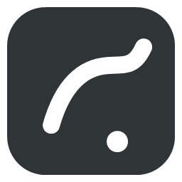
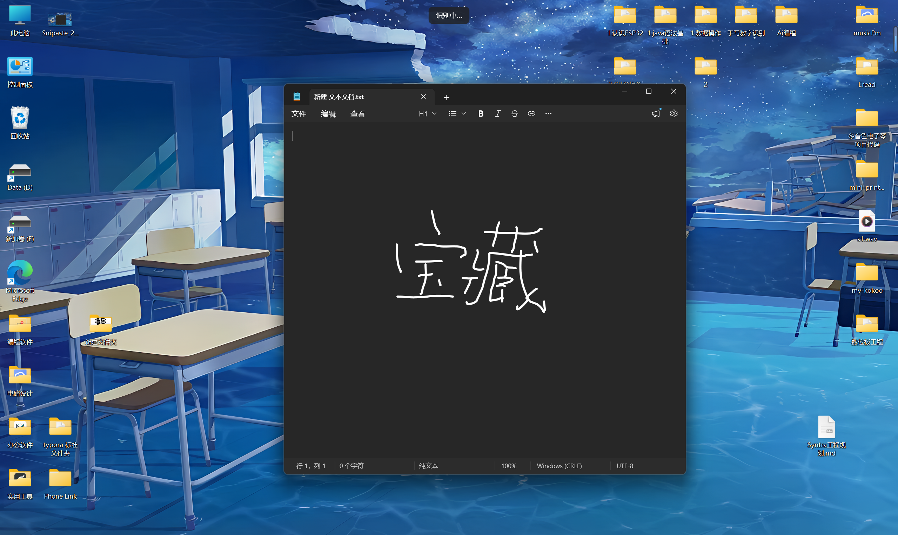
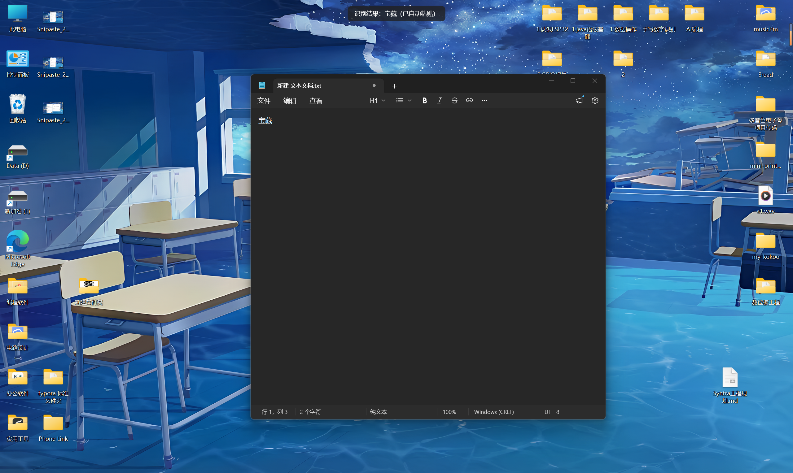
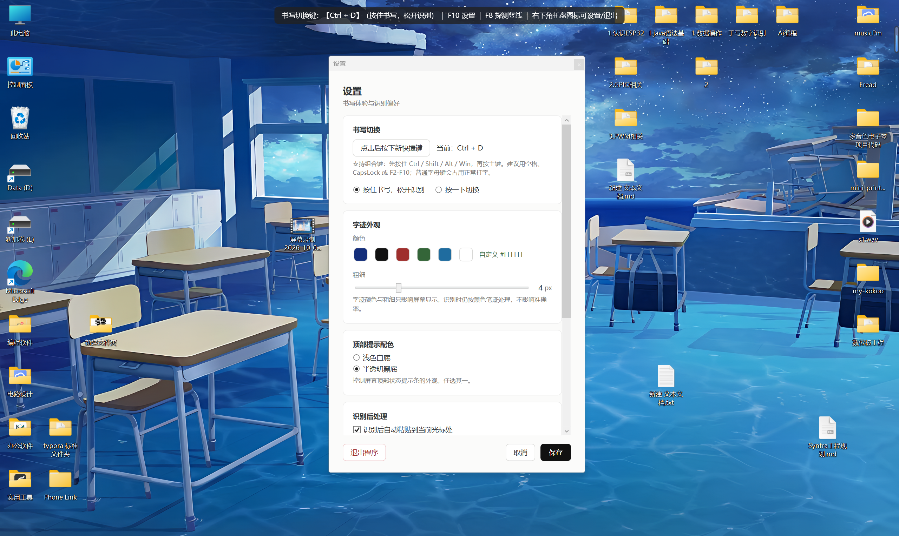
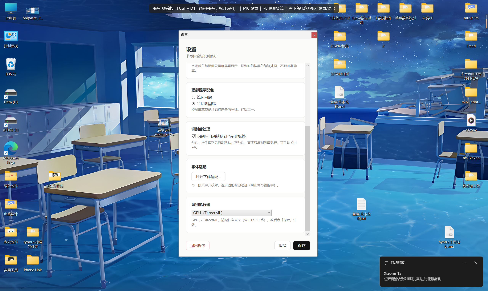
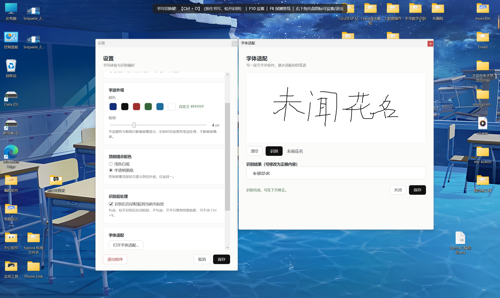
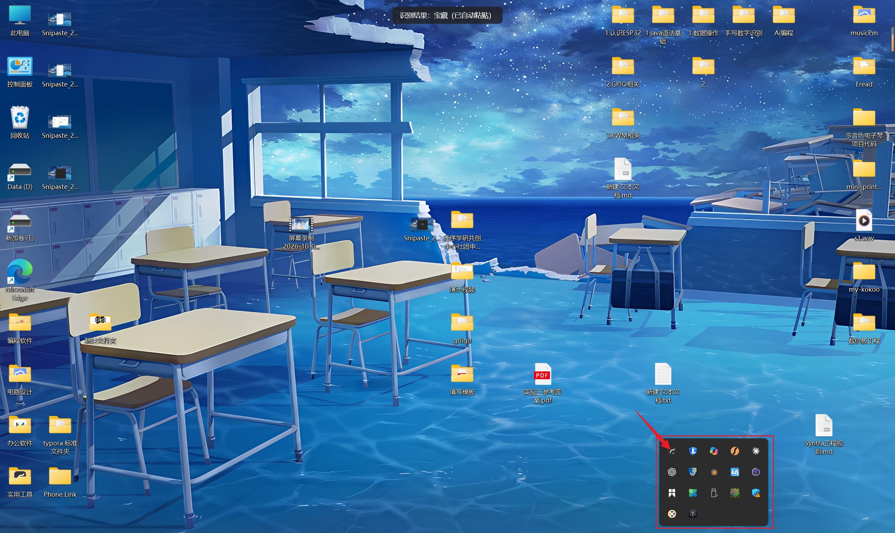

  <h1 align="center">
    
     
    Handwrite Input
  </h1>

 

  
  
  

 

🌟 Star this repo to get notified of updates on your GitHub homepage!

 

[English](./README.en-US.md) | [中文](../../README.md)

Handwrite Input — a local-OCR based handwriting input tool for Windows. Write anywhere on screen with your pen tablet (or mouse), and it's recognized into text and pasted at the cursor.

## Features

* Writing & recognition
  * [Full-screen writing](https://github.com/zhangrui123456-maker/handwrite-input): hold the toggle key (default `Ctrl+D`) to write anywhere on screen, release to recognize
  * [Offline recognition](https://github.com/zhangrui123456-maker/handwrite-input): built-in PaddleOCR PP-OCRv6, fully local, no internet required
  * [GPU acceleration](https://github.com/zhangrui123456-maker/handwrite-input): DirectML inference, works with any GPU (including RTX 50 series), with CPU fallback
* Output
  * [Auto paste](https://github.com/zhangrui123456-maker/handwrite-input): auto `Ctrl+V` at the cursor, or copy-only for manual paste
  * [Top banner](https://github.com/zhangrui123456-maker/handwrite-input): recognized text shown in a banner at the top of the screen
* Personal adaptation
  * [Handwriting adaptation](https://github.com/zhangrui123456-maker/handwrite-input): collects "wrong → right" corrections during calibration to adapt to your handwriting (no model retraining)
* Appearance
  * [Ink color](https://github.com/zhangrui123456-maker/handwrite-input): 5 presets + custom color picker, thickness 2–10px
  * [Banner theme](https://github.com/zhangrui123456-maker/handwrite-input): light white / translucent black

## Screenshots

**Writing & recognition**

**Settings & adaptation**

## Download

> [!NOTE]
> Download: [⚡Github Releases](https://github.com/zhangrui123456-maker/handwrite-input/releases)
>
> Grab `HandwriteInput.msi` from the Releases page and double-click to install. The installer bundles the .NET runtime, DirectML and OCR models — no prerequisites needed on the target machine.

## Usage

OCR recognition needs some compute; first recognition on low-end machines may be slow (it warms up afterward).

Your system needs:
  * Windows 10 or later, 64-bit
  * The installer bundles .NET 8 runtime and OCR models — nothing extra to install
  * GPU acceleration requires a DirectX 12 (DirectML) capable GPU; otherwise it falls back to CPU

**⚠️ Notes:**
1. The default toggle key is `Ctrl+D` (hold to write, release to recognize). Change it in Settings if it conflicts with other software.
2. Keep strokes complete and clear; single-line writing gives the best results.
3. Auto paste sends `Ctrl+V` to the focused window; some security software may block simulated keystrokes — add the app to the allowlist.

**After installing, launch from the desktop/Start-menu shortcut, then hold the toggle key to write.** Steps:

1. Double-click the "Handwrite Input" desktop shortcut (it runs in the system tray).
2. Place the cursor where you want to input text.
3. Hold the toggle key `Ctrl+D` and write anywhere on screen with your mouse/pen tablet.
4. Release the toggle key; the text is recognized and pasted at the cursor.
5. Right-click the tray icon to open Settings or Handwriting Adaptation.

## FAQ

* Why is the recognition wrong?
  * Write larger and clearer, ideally a single line. You can also use "Handwriting Adaptation" to write a phrase and correct it, so the app gradually adapts to your handwriting.
* Recognition is slow?
  * Make sure the recognition provider is "Auto" or "GPU (DirectML)" in Settings. Choose "CPU" if you have no discrete GPU.
* Does it need internet?
  * No. Recognition is fully local and offline; models are bundled in the installer.
* How do I change the toggle key?
  * Right-click the tray icon → Settings, click the key area and press a new combo, then save.

## Acknowledgements

This project builds on:

* [PaddleOCR](https://github.com/PaddlePaddle/PaddleOCR)
* [RapidOCR](https://github.com/RapidAI/RapidOCR)
* [OpenCvSharp](https://github.com/shimat/opencvsharp)
* [ONNX Runtime](https://github.com/microsoft/onnxruntime)
* [WiX Toolset](https://github.com/wixtoolset/wix)

## Developers

[How to build?](./build.md)

* Requires .NET 8 SDK (x64)
* Model weights are too large for the repo; run `bash download-models.sh` before the first build to fetch them from ModelScope
* Build the installer with `bash build-installer.sh <version>`

## License

This project is licensed under the [GNU General Public License v3.0](../../LICENSE).

## Feedback

Open an [Issue](https://github.com/zhangrui123456-maker/handwrite-input/issues)
