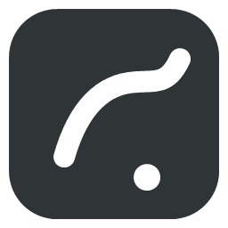
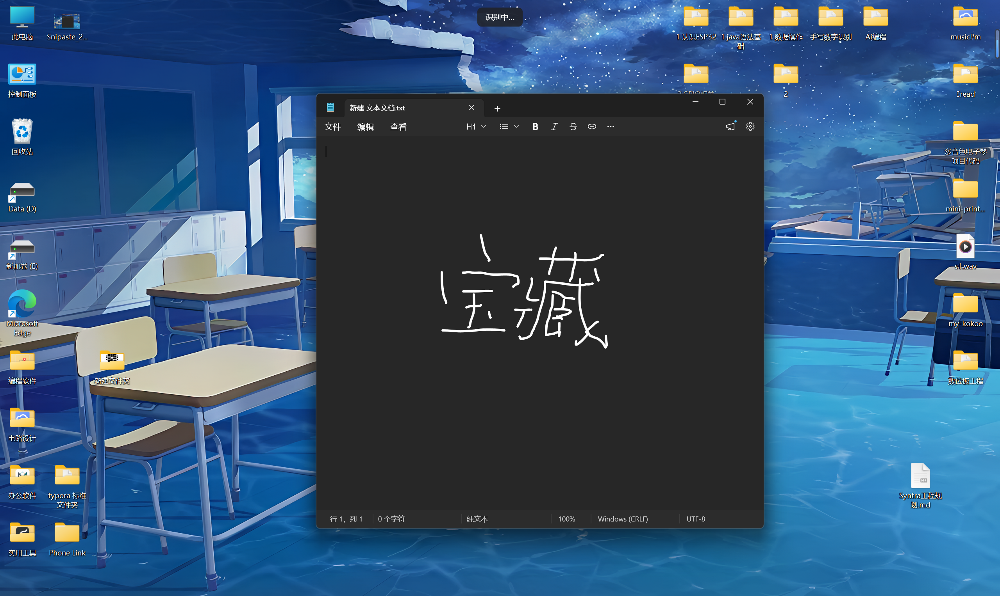
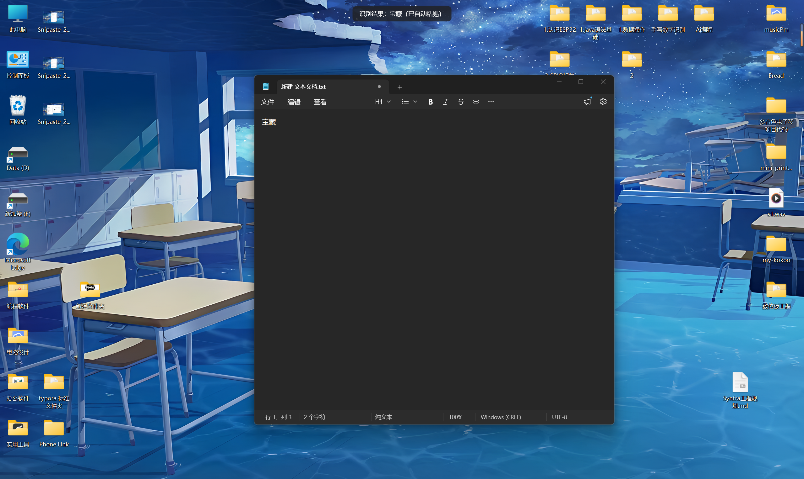
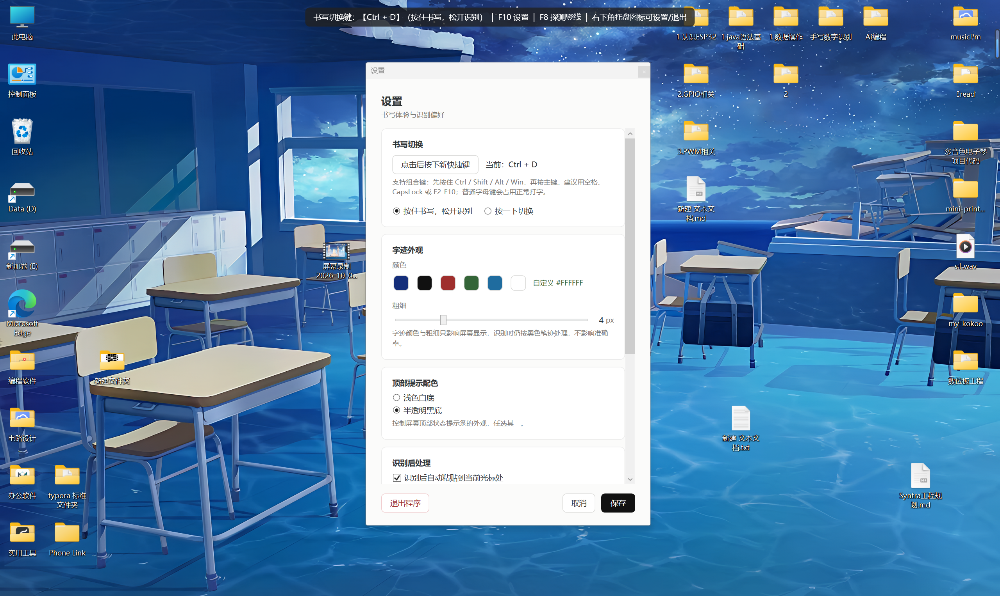
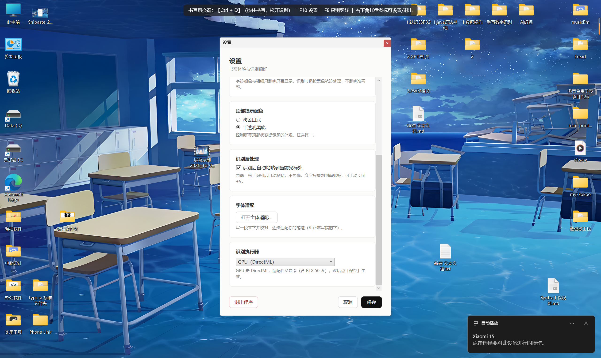
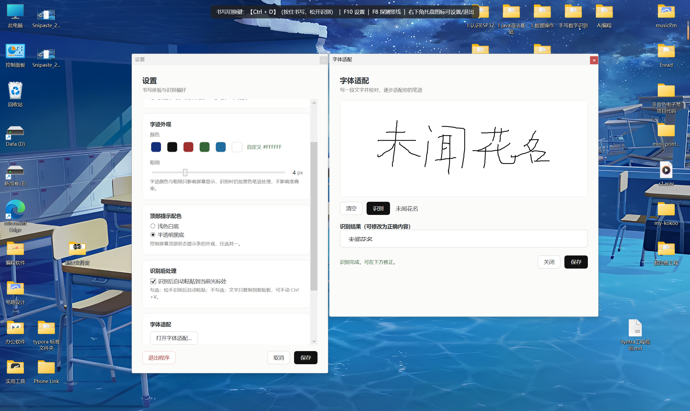
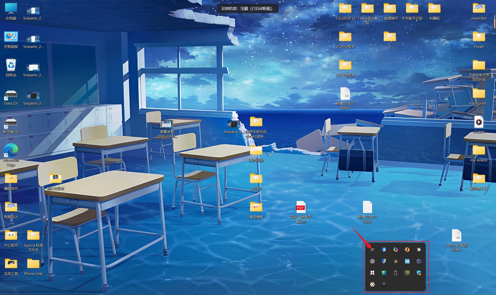

  <h1 align="center">
    
     
    数位板手写输入
  </h1>

 

  
  
  

 

🌟 点一下右上角的 Star，主页就能收到软件更新通知了哦~

 

[English](./Docs/i18n/README.en-US.md) | [中文](./README.md)

数位板手写输入 —— 一个基于本地 OCR 的 Windows 手写输入工具，让数位板（或鼠标）在屏幕任意位置书写，识别成文字并自动粘贴到光标处。

## 功能

* 书写识别
  * [全屏书写](https://github.com/zhangrui123456-maker/handwrite-input)：按住切换键（默认 `Ctrl+D`）在屏幕任意位置书写，松手自动识别
  * [离线识别](https://github.com/zhangrui123456-maker/handwrite-input)：内置 PaddleOCR PP-OCRv6，纯本地推理，无需联网
  * [GPU 加速](https://github.com/zhangrui123456-maker/handwrite-input)：DirectML 推理，适配任意显卡（含 RTX 50 系），可回退 CPU
* 输出方式
  * [自动粘贴](https://github.com/zhangrui123456-maker/handwrite-input)：识别后自动 `Ctrl+V` 到当前光标处，也可仅复制手动粘贴
  * [顶部提示](https://github.com/zhangrui123456-maker/handwrite-input)：识别文字显示在屏幕顶部状态栏
* 个人适配
  * [字体适配](https://github.com/zhangrui123456-maker/handwrite-input)：校准阶段收集「错字 → 正确字」纠正对，逐步适配你的笔迹（不改模型）
* 外观定制
  * [墨迹颜色](https://github.com/zhangrui123456-maker/handwrite-input)：5 种预设 + 自定义取色，粗细 2–10px
  * [提示配色](https://github.com/zhangrui123456-maker/handwrite-input)：浅色白底 / 半透明黑底

## 截图

**书写与识别**

**设置与适配**

## 下载

> [!NOTE]
> 下载地址：[⚡Github 下载](https://github.com/zhangrui123456-maker/handwrite-input/releases)
>
> 在 Releases 页下载 `HandwriteInput.msi`，双击安装即可。安装包已内置 .NET 运行时、DirectML 与 OCR 模型，目标机器无需预装任何环境。

## 使用方法

由于 OCR 识别需要一定算力，低配置电脑首次识别可能稍慢（后续会缓存并热机）。

你的系统需要满足以下条件：
  * Windows 10 或更高版本的 64 位系统
  * 安装包已内置 .NET 8 运行时与 OCR 模型，无需额外安装
  * 使用 GPU 加速需要显卡支持 DirectX 12（DirectML），否则自动回退 CPU

**⚠️ 注意：**
1. 切换键默认是 `Ctrl+D`（按住书写、松开识别）。若与输入法或其他软件冲突，可在设置里改。
2. 识别时请保持笔画完整、字迹清楚，单行书写识别效果最佳。
3. 自动粘贴会向当前焦点窗口发送 `Ctrl+V`，个别安全软件可能拦截模拟按键，请加入白名单。

**安装后，从桌面或开始菜单启动软件，按住切换键开始书写即可。** 详细步骤：

1. 双击桌面「数位板手写输入」快捷方式启动（图标在系统托盘）。
2. 把光标定位到要输入文字的地方。
3. 按住切换键 `Ctrl+D`，在屏幕任意位置用鼠标/数位板书写。
4. 松开切换键，文字自动识别并粘贴到光标处。
5. 右键托盘图标可打开「设置」或「字体适配」。

## FAQ

* 为什么识别结果不对？
  * 请尝试把字写大一点、笔画清楚一点，单行书写。也可以在「字体适配」里写一段文字并校对，让软件逐步适配你的笔迹。
* 识别很慢怎么办？
  * 确认设置里「识别执行器」是「自动」或「GPU（DirectML）」。没有独显时可选「CPU」。
* 需要联网吗？
  * 不需要。识别全程本地离线完成，模型已内置在安装包中。
* 怎么改切换键？
  * 右键托盘图标 →「设置」，点击切换键区域后按下新组合键，保存即可。

## 致谢

本项目的完成离不开以下项目：

* [PaddleOCR](https://github.com/PaddlePaddle/PaddleOCR)
* [RapidOCR](https://github.com/RapidAI/RapidOCR)
* [OpenCvSharp](https://github.com/shimat/opencvsharp)
* [ONNX Runtime](https://github.com/microsoft/onnxruntime)
* [WiX Toolset](https://github.com/wixtoolset/wix)

## 开发者

[如何编译项目？](./Docs/build.md)

* 构建需要 .NET 8 SDK（x64）
* 模型权重体积较大未入仓库，首次构建前运行 `bash download-models.sh` 从 ModelScope 拉取
* 打包安装程序运行 `bash build-installer.sh <版本号>`

## 许可证

本项目采用 [GNU General Public License v3.0](LICENSE) 许可证。

## 问题反馈

提 [Issue](https://github.com/zhangrui123456-maker/handwrite-input/issues)
